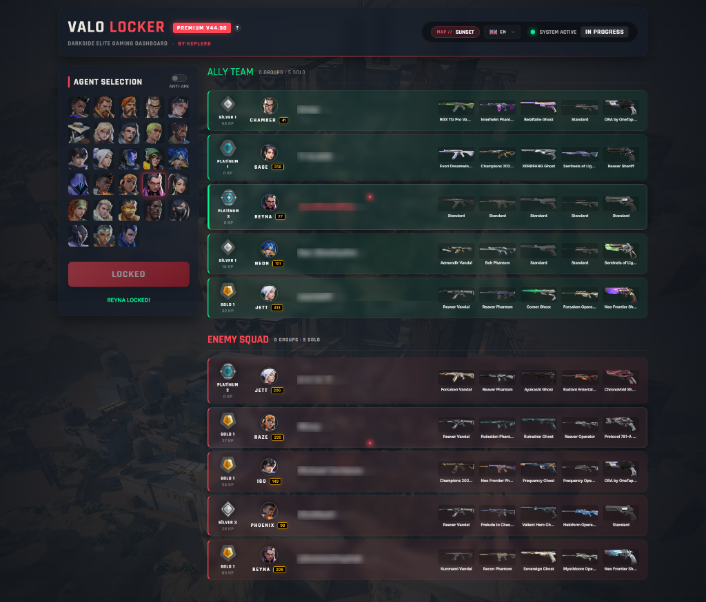

# VALORANT INSTALOCKER PRO 🛡️✨ [v44.91]

**Valorant InstaLocker PRO** is an elite, tactical dashboard designed for Valorant players who want to gain match intelligence and automate their agent selection process with style.

---

## 🇹🇷 Türkçe Tanıtım

Valorant InstaLocker PRO, Valorant oyuncuları için geliştirilmiş, üst düzey estetik ve fonksiyonelliği bir araya getiren bir taktiksel paneldir.

### 📸 Showcase / Görünüm


### 🚀 Özellikler
- **Otomatik Ajan Kilitleme**: İstediğiniz ajanı saniyeler içinde otomatik olarak kilitler.
- **Gerçek Zamanlı İstihbarat**: Maçtaki tüm oyuncuların rütbelerini (Rank), KP puanlarını ve seviyelerini anlık olarak gösterir.
- **Derin Skin Analizi**: Takım arkadaşlarınızın ve rakiplerinizin envanterindeki skinleri (Vandal, Phantom, vb.) otomatik tarar.
- **Parti Tespiti**: Kimlerin birlikte (pre-made) girdiğini akıllı algoritmasıyla saptar.
- **Anti-AFK Sistemi**: Oyun içinde AFK kalmanızı engelleyen pro-aktif hareket mekanizması.
- **Premium Arayüz**: Glassmorphism tasarımı ve modern animasyonlarla donatılmış elit dashboard.

### 🤖 Yapay Zeka Hikayesi
Bu projenin en benzersiz özelliği, arayüz tasarımından animasyonlarına, mantık yapısından dokümantasyonuna kadar **TAMAMININ Gelişmiş Yapay Zeka** kullanılarak oluşturulmuş olmasıdır. Bu, insan-yapay zeka işbirliğinin ulaştığı noktayı temsil eden bir teknoloji gösterisidir.

---

## 🇺🇸 English Description

Valorant InstaLocker PRO is a high-end tactical dashboard for Valorant, combining premium aesthetics with powerful match intelligence tools.

### 📸 Showcase / Preview


### 🚀 Features
- **Auto Insta-Lock**: Automatically locks your preferred agent in milliseconds.
- **Real-Time Intelligence**: Displays ranks, KP, and levels of all players in the match instantly.
- **Deep Skin Analysis**: Automatically scans the weapon skins (Vandal, Phantom, etc.) of allies and enemies.
- **Party Detection**: Identifies premade groups using smart tracking logic.
- **Anti-AFK System**: Pro-active movement mechanism to prevent being kicked for inactivity.
- **Premium UI**: Elite dashboard featuring high-end Glassmorphism and modern animations.

### 🤖 The AI Story
The most unique aspect of this project is that **100% of it**—including the UI design, logic, animations, and documentation—was created using **Advanced Artificial Intelligence**. It stands as a testament to the power of modern AI-human collaboration.

---

## 🛠️ Installation / Kurulum

1. Install Python 3.x
2. Clone the repository: `git clone https://github.com/Keplorions/Valorant-InstaLocker.git`
3. Install dependencies:
   ```bash
   pip install -r requirements.txt
   ```
4. Run the application:
   ```bash
   python locker.py
   ```

---

## ⚖️ License
This project is open-source and developed for educational transparency. Use responsibly.

---
**Developed by By'KeplerB & AI** 🛡️🚀🚩
