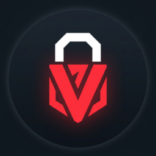
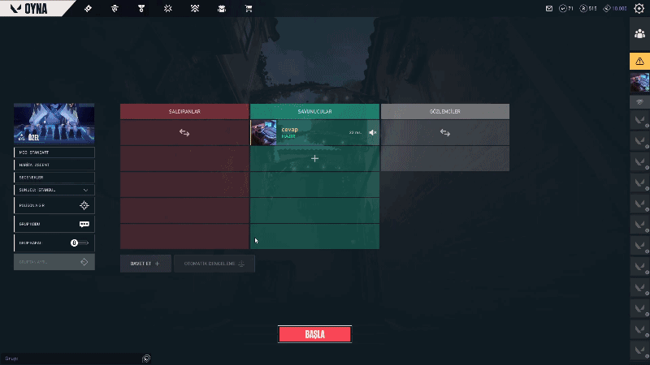
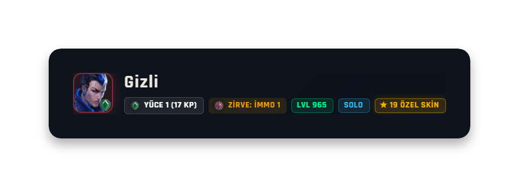
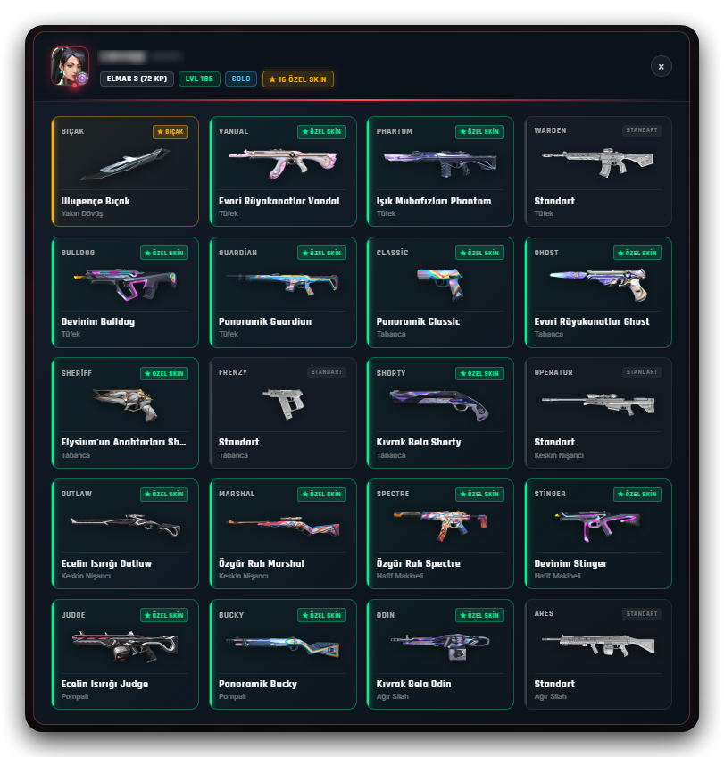
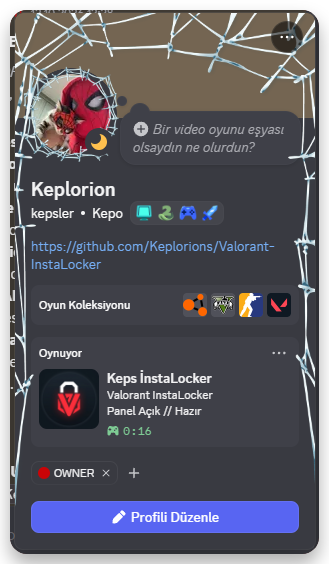
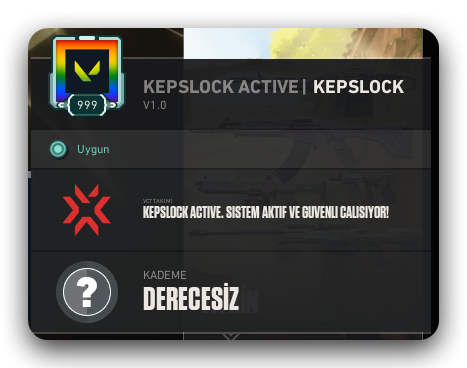
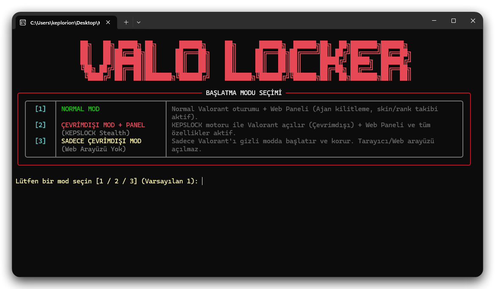
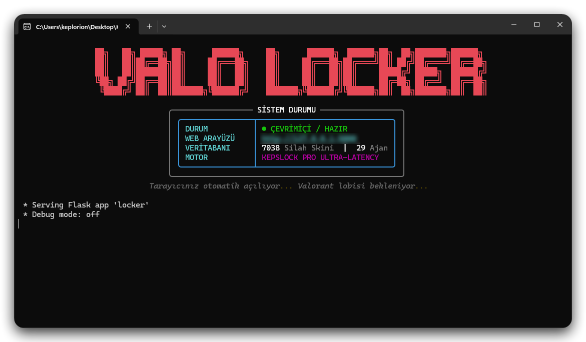
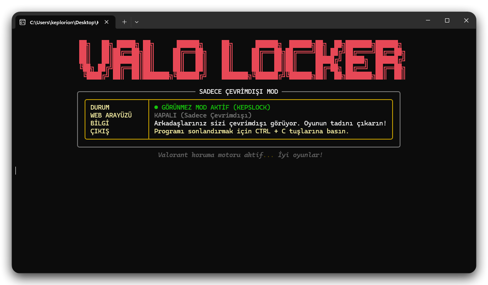

<div align="center">

<br>

# ⚡ VALORANT INSTALOCKER PRO // KEPSLOCKER 🛡️
**ELITE TACTICAL DASHBOARD, INSTALOCKER & STEALTH ENGINE**  
*Created with precision by **By'KeplerB** & Advanced Agentic AI*

[](LICENSE)
[](https://www.python.org/)
[](https://github.com/Keplorions/Valorant-InstaLocker)
[](https://github.com/Keplorions/Valorant-InstaLocker/releases)
[](https://discord.gg/kxdthnYHUP)

---

### 📸 LIVE DASHBOARD PREVIEW


<p align="center">
  <b><a href="#-english-documentation">🇺🇸 English Documentation</a></b> &nbsp;•&nbsp; 
  <b><a href="#-t%C3%BCrk%C3%A7e-dok%C3%BCmantasyon">🇹🇷 Türkçe Dokümantasyon</a></b> &nbsp;•&nbsp; 
  <b><a href="#%EF%B8%8F-visual-showcase--aray%C3%BCz-galerisi">🖼️ Visual Showcase</a></b> &nbsp;•&nbsp; 
  <b><a href="#-setup--installation">🚀 Installation</a></b>
</p>

</div>

---

## 🖼️ Visual Showcase / Arayüz Galerisi

### ⚡ Millisecond InstaLock in Action / Milisaniyelik InstaLock
<div align="center">
  
  <p><i>Sub-millisecond instant agent auto-locking the exact moment character selection begins.<br>Ajan seçim ekranı açıldığı mikrosaniyede otomatik kilitleme aksiyonu.</i></p>
</div>

<br>

<table align="center" width="100%">
  <tr>
    <td width="50%" align="center" valign="top">
      <b>👑 Career Peak Rank (Historical MMR) Detection</b><br>
      <br>
      <small><i>Identifies all-time highest ranks & official Riot emblems across all 10 players.<br>10 oyuncunun geçmiş tüm sezonluk MMR ve kariyer zirvesi rütbe tespiti.</i></small>
    </td>
    <td width="50%" align="center" valign="top">
      <b>🔍 Real-Time Weapon & Skin Inspector</b><br>
      <br>
      <small><i>Inspects equipped weapons, melee knives, chromas, and upgrade levels pre-match.<br>Kuşanılmış tüm silah skinleri, bıçaklar ve yükseltme seviyeleri.</i></small>
    </td>
  </tr>
  <tr>
    <td width="50%" align="center" valign="top">
      <b>🎮 Discord Live Rich Presence (RPC)</b><br>
      <br>
      <small><i>Automated live Discord status showing session timers and lobby readiness.<br>Discord profilinde otomatik panel açık ve hazır durum rozeti.</i></small>
    </td>
    <td width="50%" align="center" valign="top">
      <b>👻 In-Game Stealth Presence Card</b><br>
      <br>
      <small><i>Appear completely offline to your friends list with 100% passive local proxies.<br>Arkadaş listenize görünmez olarak oyun oynama imkanı.</i></small>
    </td>
  </tr>
  <tr>
    <td width="50%" align="center" valign="top">
      <b>💻 CLI Startup Mode Selection</b><br>
      
    </td>
    <td width="50%" align="center" valign="top">
      <b>🟢 CLI Online & Ready Status</b><br>
      
    </td>
  </tr>
  <tr>
    <td colspan="2" align="center" valign="top">
      <b>🌙 Standalone Offline / Stealth Terminal Mode</b><br>
      <br>
      <small><i>Zero CPU / RAM footprint terminal mode for distraction-free gaming.<br>Sıfır sistem kaynağı tüketen minimal komut satırı modu.</i></small>
    </td>
  </tr>
</table>

---

## 🇺🇸 English Documentation

**Valorant InstaLocker PRO** *(KepsLocker)* is an elite tactical dashboard and agent auto-locking tool engineered for competitive VALORANT players. It combines millisecond-fast agent locking with in-depth match intelligence, all-time career peak rank detection, live lobby skin inspection, anti-AFK protection, and a built-in stealth engine allowing you to appear offline to your friends list.

### 🌟 Key Features

* 🎯 **Sub-Millisecond InstaLock (29 Agents):** Instantly selects and locks your favorite agent (0.02s reaction speed) the moment character select opens via local client websockets.
* 👑 **Career Peak Rank & Historical MMR Scanner:** Automatically queries past competitive seasons for all 10 players to reveal their all-time peak rank badges (Radiant, Immortal, Ascendant, etc.), identifying smurfs or ex-high-elo players in lower lobbies.
* 🔍 **Deep Weapon Skin & Inventory Scanner:** Scans and displays the weapon skins (Vandal, Phantom, Melee, Operator, etc.), chroma variants, and VFX levels of all 10 players in real time.
* 🎮 **Live Discord Rich Presence (RPC):** Automatically connects via local IPC to display an activity status ("Keps InstaLocker // Panel Active // Ready") with live elapsed timers on your Discord profile.
* 👻 **Stealth / Appear Offline Mode:** Hides your presence from your Riot friends list completely while setting a custom encrypted presence card in-game.
* 🛡️ **Intelligent Anti-AFK Simulation:** Subtle, randomized human-cadence simulation mechanism preventing idle disconnects and queue bans without triggering anticheat.
* 👥 **Ally Party & Premade Detection:** Pinpoints premade duos and trios on your team with color-coded party badges (`GRP 1`, `GRP 2`, `SOLO`) in under 0.2 seconds.
* 🌐 **Modern Glassmorphic Web UI:** Dark sci-fi aesthetic with interactive logo, multilingual toggle (TR/EN), and live map backgrounds.
* ⚡ **3 Flexible Launch Modes:**
  1. `[1]` **Standard Web Mode:** Web dashboard + auto-lock + live lobby stats.
  2. `[2]` **Web + Stealth Mode:** Full web dashboard while appearing offline to your friends.
  3. `[3]` **Standalone Stealth Mode:** Lightweight background engine without opening a web browser.
* 📦 **1-Click Portable EXE:** Run instantly with no dependencies, or compile your own standalone `.exe` with the included `build_exe.bat`.

---

### 🛡️ Safety & Anti-Cheat Compliance

* **No Memory Hooking / No DLL Injection:** KepsLocker operates strictly through Riot's official **Local Client API** (`127.0.0.1` LCU/GLZ endpoints), exactly like legitimate companion apps (*Blitz.gg, Tracker.gg, Outplayed*).
* **Vanguard Friendly:** No game memory or file integrity is modified; completely safe.
* *Disclaimer: While engineered to remain strictly within passive API boundaries, any third-party tool usage is at your own discretion.*

---

### 🚀 Setup & Installation

#### Option 1: Standalone Portable EXE (Recommended)
1. Download `KepsLocker.exe` from the [Releases](https://github.com/Keplorions/Valorant-InstaLocker/releases) tab.
2. Run `KepsLocker.exe` as Administrator.
3. Select your desired launch mode in the terminal.

#### Option 2: Running from Python Source
1. Ensure **Python 3.10+** is installed: [python.org](https://www.python.org/downloads/)
2. Clone the repository:
   ```bash
   git clone https://github.com/Keplorions/Valorant-InstaLocker.git
   cd Valorant-InstaLocker
   ```
3. Install dependencies:
   ```bash
   pip install -r requirements.txt
   ```
4. Start the application:
   ```bash
   python locker.py
   # Or double-click:
   Start.bat
   ```

#### Option 3: Compiling Your Own Single EXE
Double-click [`build_exe.bat`](build_exe.bat). It will automatically install PyInstaller, embed the official icon (`app.ico`), bundle `stealth_engine.dat`, and generate `dist/KepsLocker.exe`.

---

> ⚠️ **IMPORTANT USAGE NOTE FOR OFFLINE / STEALTH MODE:**
> 1. **Do NOT open VALORANT first:** When using Offline Mode, start KepsLocker first; the tool will safely launch VALORANT with the proxy parameters.
> 2. **After quitting the game:** Always fully exit **Riot Client** from the Windows system tray (bottom-right taskbar); otherwise, offline mode stays active.

---

## 🇹🇷 Türkçe Dokümantasyon

**Valorant InstaLocker PRO** *(KepsLocker)*, VALORANT oyuncuları için tasarlanmış üst seviye bir ajan kilitleyici, kariyer zirvesi analiz paneli, envanter müfettişi ve çevrimdışı mod aracıdır. Milisaniyelik kilit motoru, tüm lobinin geçmiş sezon MMR kayıtlarını ve skinlerini gösteren tarayıcısı, AFK koruması ve arkadaş listenize görünmez olmanızı sağlayan özel stealth motoru içerir.

### 🌟 Öne Çıkan Özellikler

* 🎯 **Milisaniyelik Ultra Hızlı InstaLock (29 Ajan):** Sıra bittiği ve ajan seçim ekranı açıldığı anda insan reflekslerinin çok ötesinde (0.02s) seçtiğiniz ajanı anında kilitler.
* 👑 **Kariyer Zirvesi (Peak Rank) Tespiti:** Lobideki 10 oyuncunun geçmiş tüm rekabetçi sezon kayıtlarını tarayarak ulaştıkları en tepe kariyer rütbelerini ve resmi rozetlerini (Radyant, Immortal, Yücelik vb.) gösterir; smurf ve gizli yüksek elo oyuncuları anında açığa çıkarır.
* 🔍 **Canlı Silah & Skin Müfettişi:** Lobideki 10 oyuncunun da elindeki silah skinlerini (Vandal, Phantom, Bıçak, Operatör vb.), renk varyantlarını ve özel VFX seviyelerini canlı analiz eder.
* 🎮 **Canlı Discord Durum Entegrasyonu (RPC):** Discord profilinizde otomatik olarak "Keps İnstaLocker // Panel Açık // Hazır" durumunu ve sayaç rozetini arkadaş listenize şık bir kart olarak yansıtır.
* 👻 **Çevrimdışı (Görünmez) Mod:** Arkadaş listenizde tamamen çevrimdışı görünerek rahatsız edilmeden ve gizlice oyun oynamanızı sağlar.
* 🛡️ **Akıllı Anti-AFK Koruması:** Özel maçlarda veya derecesiz oyunlarda AFK düşmenizi ve sıra cezası almanızı önleyen, insan ritmini taklit eden mikrosaniyelik simülasyon.
* 👥 **Lobi & Premade Parti Tespiti:** Takımınızda kimlerin beraber hazır grup girdiğini özel renk kodlarıyla (`GRP 1`, `GRP 2`, `SOLO`) saniyeler içinde çözümler.
* 🌐 **Modern Glassmorphism Web Paneli:** Karanlık sci-fi tema, tıklanınca sayfayı yenileyen interaktif logo, Türkçe/İngilizce dil seçeneği ve harita arka planı.
* ⚡ **3 Farklı Başlatma Seçeneği:**
  1. `[1]` **Normal Web Modu:** Web arayüzü + hızlı kilit + lobi takibi.
  2. `[2]` **Web + Çevrimdışı Mod:** Hem web panelini kullanın hem de arkadaş listenize çevrimdışı görünün.
  3. `[3]` **Sadece Çevrimdışı Mod:** Web tarayıcısı açılmadan sadece gizli modda sessizce oynamak isteyenler için.
* 📦 **Tek Tıkla Taşınabilir EXE Derleme:** `build_exe.bat` dosyasını çalıştırarak logonun da gömülü olduğu tek parça `.exe` üretebilirsiniz.

---

### 🛡️ Güvenlik & Ban Riski

* **Bellek Enjeksiyonu Yoktur:** Oyunun belleğine kod enjekte etmez (Memory injection / Hooking yapmaz). Riot'un kendi yerel istemci API protokollerini (`127.0.0.1` LCU/GLZ) kullanır. Blitz veya Tracker Network gibi resmi izinli programlarla aynı mimariyi paylaşır.
* **Vanguard Uyumludur:** Oyun dosyalarında herhangi bir değişiklik yapmaz; %100 güvenlidir.
* *Sorumluluk Reddi: Uygulama en pasif ve güvenli API yöntemleriyle geliştirilmiş olsa da, tüm 3. parti yazılımlarda olduğu gibi kullanım sorumluluğu son kullanıcıya aittir.*

---

### 🚀 Kurulum ve Çalıştırma

#### Seçenek 1: Tek Parça EXE Sürümü (Önerilen)
1. [Releases](https://github.com/Keplorions/Valorant-InstaLocker/releases) sekmesinden güncel `KepsLocker.exe` dosyasını indirin.
2. `KepsLocker.exe` dosyasını yönetici olarak başlatın.
3. Açılan terminal ekranından dilediğiniz başlatma modunu seçin.

#### Seçenek 2: Python Kaynak Kodundan Çalıştırma
1. **Python 3.10+** kurulu olduğundan emin olun: [python.org](https://www.python.org/downloads/)
2. Projeyi indirin veya klonlayın:
   ```bash
   git clone https://github.com/Keplorions/Valorant-InstaLocker.git
   cd Valorant-InstaLocker
   ```
3. Gereksinimleri yükleyin:
   ```bash
   pip install -r requirements.txt
   ```
4. Programı başlatın:
   ```bash
   python locker.py
   # veya doğrudan:
   Start.bat
   ```

#### Seçenek 3: Kendi Tek Parça EXE Dosyanızı Üretme
[`build_exe.bat`](build_exe.bat) dosyasına çift tıklayın. Otomatik olarak PyInstaller'ı kuracak, logoyu (`app.ico`) ve `stealth_engine.dat` dosyasını gömerek `dist/KepsLocker.exe` dosyasını oluşturacaktır.

---

> ⚠️ **ÇEVRİMDISI (STEALTH) MOD İÇİN ÖNEMLİ KULLANIM KURALI:**
> 1. **Oyunu Önceden Açmayın:** Çevrimdışı mod kullanacaksanız VALORANT'ı önceden açmayın; önce KepsLocker'ı başlatın, oyun program tarafından otomatik açılacaktır.
> 2. **Oyundan Çıkışta:** Oyunu kapattıktan sonra görev çubuğunun sağ altındaki bildirim alanından **Riot Client** uygulamasını tamamen kapatın; aksi halde çevrimdışı mod açık kalmaya devam eder.

---

## ⚖️ License & Credits

Distributed under the **MIT License**. See [`LICENSE`](LICENSE) for more information.

<div align="center">

**Developed with ❤️ by By'KeplerB & AI Community** 🛡️🚀  
Join our community on [Discord](https://discord.gg/kxdthnYHUP) for updates, feature requests, and support!

</div>
